<!-- ═══════════════════════════════════════════════════════════════
     SAHIL KARANDE · GitHub Profile
     Theme: Night Patrol — red & blue web-slinger
     Before pushing: replace every YOUR_GITHUB_USERNAME with your handle
     ═══════════════════════════════════════════════════════════════ -->

<div align="center">




<p>
<a href="https://www.linkedin.com/in/sahil-karande-a77aa7207/"></a>
<a href="mailto:skarande220@gmail.com"></a>
<a href="https://skarande220.pythonanywhere.com"></a>

</p>

</div>


## 🕷️ Origin Story

<table>
<tr>
<td width="52%" valign="top">

By day, I'm a **Project Engineer at CDAC Mumbai**. By night, I'm still wiring pipelines together, just with more coffee.

I hold a B.Tech in Computer Engineering and a PG-DBDA, and I like the whole web of a system: backend services, data streams, the ML models in the middle, and the people who use what comes out.

> *"I don't just want to build features. I want to understand, engineer, and improve the systems behind them."*

🎯 **Mission:** turn complex technical ideas into useful, reliable applications.

</td>
<td width="48%" valign="top">

```python
class Sahil(Engineer):
    base     = "CDAC Mumbai 🏙️"
    powers   = ["AI Engineering",
                "Machine Learning",
                "Data Engineering"]
    focus    = ["real-time streams",
                "intelligent automation"]
    side_job = "mentor & assessment designer"

    def patrol(self):
        while city.has_problems():
            self.build()
            self.measure()
            self.improve()
```

</td>
</tr>
</table>

<details>
<summary><b>🕸️ Spider-sense readout</b>: what I'm tuned into right now</summary>

<br/>

```
THREAD                       SIGNAL        STATUS
────────────────────────────────────────────────────────
ai-engineering               ██████████    🔴 SWINGING
real-time-pipelines          █████████░    🔴 SWINGING
machine-learning             █████████░    🔴 SWINGING
backend-architecture         ████████░░    🔵 HOLDING
cloud-and-deployment         ███████░░░    🔵 TRAINING
technical-mentoring          █████████░    🔴 SWINGING
```

</details>


## 🦸 Case Files

<table>
<tr>
<td width="50%" valign="top">

### 👁️ NETRA-I
<sub>`CASE #001` · 🚧 IN DEVELOPMENT</sub>

**Intelligent exam & proctoring platform.** Student verification with OTP, face calibration, camera monitoring, timed exams, tab-switch tracking and faculty analytics. Offline mode is next.


</td>
<td width="50%" valign="top">

### 🏢 Abhilekh
<sub>`CASE #002` · 🔬 EXPLORATION</sub>

**AI document intelligence.** Smart document processing and AI-assisted extraction on an API-first backend with structured storage.


</td>
</tr>
<tr>
<td width="50%" valign="top">

### 🧠 NeuroAI
<sub>`CASE #003` · 🧪 AI × DATA ENG</sub>

**Real-time mood detection** from voice and text. Hugging Face models do emotion inference on a streaming pipeline.


</td>
<td width="50%" valign="top">

### 📊 Analytics Squad
<sub>`CASE #004` · 📈 SHIPPED</sub>

**🏨 Hotel Booking Intelligence:** cancellation patterns in Power BI.<br/>
**🚗 Used Cars Market:** pricing trends in a Streamlit dashboard.


</td>
</tr>
</table>


## 🧰 Utility Belt

<div align="center">


</div>

<details>
<summary><b>🔓 Open the full gadget inventory</b></summary>

<br/>

| Gadget | Loaded With |
|---|---|
| ⚔️ **Languages** | Python · Java · SQL · JavaScript |
| 🌊 **Data Engineering** | Apache Kafka · Apache Spark · PySpark · Hadoop |
| 🗄️ **Databases** | MySQL · MongoDB · PostgreSQL · Cassandra |
| 🧠 **AI / ML** | ML · Deep Learning · NLP · Computer Vision · Hugging Face · LLMs |
| 🕸️ **Backend** | Flask · FastAPI · Node.js · REST APIs |
| 📊 **Analytics** | Power BI · Tableau · Streamlit · Pandas · NumPy |
| ☁️ **Cloud & DevOps** | AWS · Azure · GCP · Linux · Git · GitHub |

</details>


## 📡 Patrol Report

<div align="center">


### 🏙️ The City I Protect
<sub>My contributions rendered as a 3D night skyline. It updates daily.</sub>


### 🕷️ Spider on the Grid


</div>

<details>
<summary><b>📈 Night-shift activity graph</b></summary>

<br/>


</details>


## 🎯 Current Missions

<table>
<tr>
<td width="50%" valign="top">

**🔴 Active**
- 🏗️ Making NETRA-I deployment-ready
- 🌊 Going deeper into distributed & real-time systems
- 🤖 Shipping practical AI with solid backends

</td>
<td width="50%" valign="top">

**🔵 In Training**
- ☁️ Cloud architecture & deployment
- 🧪 Testing, observability, security & performance
- 🧑‍🏫 Better learning experiences for students

</td>
</tr>
</table>

<details>
<summary><b>🧠 How I build</b>: the web blueprint</summary>

<br/>

```yaml
engineering_mindset:
  architecture:   # every strand has a purpose
    - Build modular, maintainable systems
    - Design clear interfaces between components
  data:           # a web is only as strong as its anchors
    - Prioritize data quality and reliability
    - Understand pipelines from ingestion to consumption
  intelligence:   # power needs judgement
    - Apply AI where it solves a real problem
    - Evaluate models beyond simply making predictions
  delivery:       # test the swing before the jump
    - Test before deploying
    - Measure performance and improve iteratively
  collaboration:  # nobody patrols the city alone
    - Share knowledge
    - Learn through building and feedback
```

</details>

<details>
<summary><b>🌆 Off duty</b></summary>

<br/>

🧑‍🏫 Mentoring & designing assessments &nbsp;·&nbsp; 📚 Books & new tech &nbsp;·&nbsp; 📷 Photography &nbsp;·&nbsp; 🧩 Building & breaking things to learn

</details>

<br/>

<div align="center">


<br/><br/>


</div>
